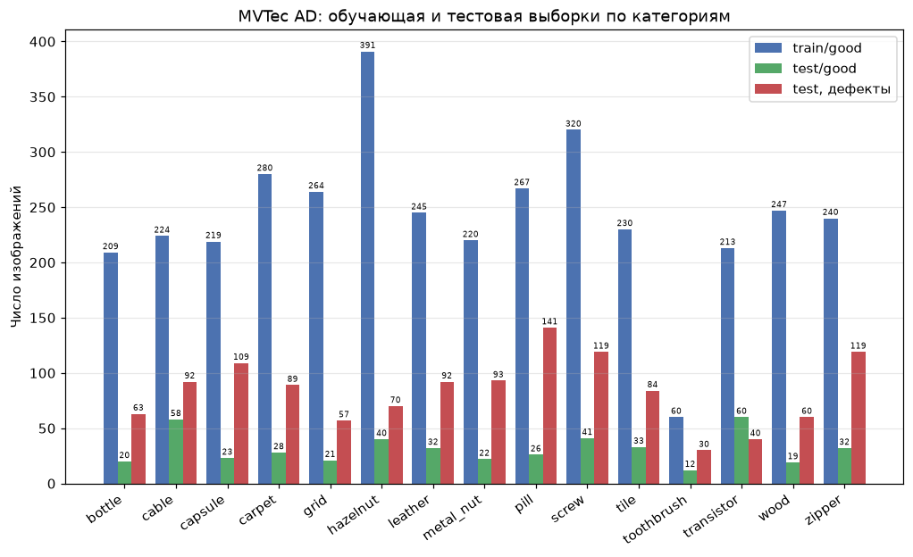
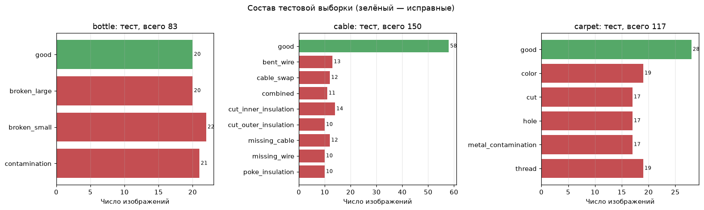
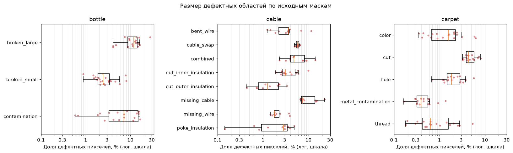
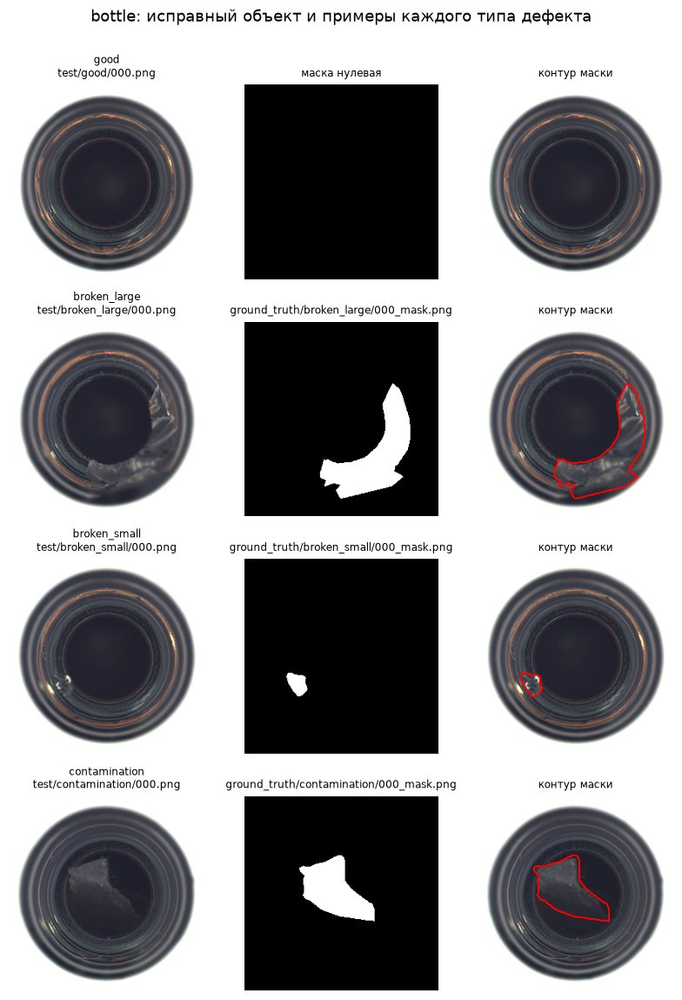
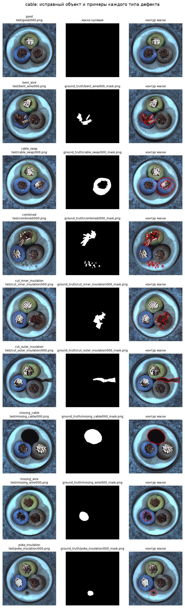
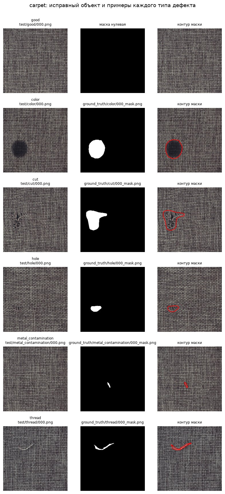

# Анализ датасета MVTec AD

> Исходный материал для раздела «Датасет и подготовка данных» общего отчёта команды. Это не окончательный отчёт по ГОСТу: текст, таблицы и рисунки предназначены для переноса в итоговый документ.
>
> Все числа ниже получены скриптом `scripts/analyze_dataset.py` на полном локальном наборе и взяты из файлов [`results/dataset_summary.csv`](../results/dataset_summary.csv), [`results/defect_summary.csv`](../results/defect_summary.csv), [`results/data_quality.json`](../results/data_quality.json) и [`results/eda/mask_stats.csv`](../results/eda/mask_stats.csv).

## 1. Источник, назначение и лицензия

- **Источник:** MVTec Anomaly Detection Dataset (MVTec AD), официальная страница — <https://www.mvtec.com/research-teaching/datasets/mvtec-ad>.
- **Публикация:** P. Bergmann, M. Fauser, D. Sattlegger, C. Steger. *A Comprehensive Real-World Dataset for Unsupervised Anomaly Detection.* CVPR 2019 (ссылка для цитирования указана в `readme.txt` каждой категории).
- **Назначение:** обучение без учителя и оценка методов обнаружения и локализации аномалий на промышленных изображениях: модель видит только исправные объекты, а на тесте должна находить дефекты на уровне изображения и пикселей.
- **Лицензия:** Creative Commons Attribution-NonCommercial-ShareAlike 4.0 International (CC BY-NC-SA 4.0), © 2019 MVTec Software GmbH. Файлы `license.txt` и `readme.txt` лежат в каждой из 15 категорий. Коммерческое использование запрещено; датасет в репозиторий не добавляется.

## 2. Фактически найденные категории и объём данных

Найдены все 15 ожидаемых категорий, лишних каталогов в корне нет. Прочитано 5354 изображения и 1258 масок, проверено 1258 пар «изображение — маска».

| Категория | train/good | test/good | test, дефекты | test всего | Типов дефектов | Масок | Размер, px |
| --- | ---: | ---: | ---: | ---: | ---: | ---: | --- |
| bottle | 209 | 20 | 63 | 83 | 3 | 63 | 900 × 900 |
| cable | 224 | 58 | 92 | 150 | 8 | 92 | 1024 × 1024 |
| capsule | 219 | 23 | 109 | 132 | 5 | 109 | 1000 × 1000 |
| carpet | 280 | 28 | 89 | 117 | 5 | 89 | 1024 × 1024 |
| grid | 264 | 21 | 57 | 78 | 5 | 57 | 1024 × 1024 |
| hazelnut | 391 | 40 | 70 | 110 | 4 | 70 | 1024 × 1024 |
| leather | 245 | 32 | 92 | 124 | 5 | 92 | 1024 × 1024 |
| metal_nut | 220 | 22 | 93 | 115 | 4 | 93 | 700 × 700 |
| pill | 267 | 26 | 141 | 167 | 7 | 141 | 800 × 800 |
| screw | 320 | 41 | 119 | 160 | 5 | 119 | 1024 × 1024 |
| tile | 230 | 33 | 84 | 117 | 5 | 84 | 840 × 840 |
| toothbrush | 60 | 12 | 30 | 42 | 1 | 30 | 1024 × 1024 |
| transistor | 213 | 60 | 40 | 100 | 4 | 40 | 1024 × 1024 |
| wood | 247 | 19 | 60 | 79 | 5 | 60 | 1024 × 1024 |
| zipper | 240 | 32 | 119 | 151 | 7 | 119 | 1024 × 1024 |
| **Итого** | **3629** | **467** | **1258** | **1725** | **73** | **1258** | — |

Контрольные числа пилота команды пересчитаны и совпали: bottle 209 / 83, cable 224 / 150, carpet 280 / 117 (train/good / test всего).



**Типы разметки.**

- Метка уровня изображения задаётся папкой: `test/good` — исправный объект, `test/<defect_type>` — дефект конкретного типа (73 типа на 15 категорий; полный список — `results/defect_summary.csv`).
- Попиксельная разметка — бинарные маски `ground_truth/<defect_type>/<image_stem>_mask.png` того же размера, что изображение. Во всех масках встречаются только значения 0 и 255.
- Для `train/good` и `test/good` масок нет: логическая маска таких изображений нулевая.

## 3. Штатное разбиение и обучение только на исправных объектах

Используется штатное разбиение MVTec AD без изменений:

- `train` содержит только подпапку `good` (проверено для всех 15 категорий) — это единственный источник данных для обучения PaDiM и PatchCore;
- `test` содержит исправные и дефектные изображения, `ground_truth` — маски дефектов; они используются только для оценки (image AUROC, pixel AUROC, AUPRO).

Почему обучение только на исправных объектах: на производстве дефекты редки и разнообразны, заранее собрать примеры всех типов невозможно. Методы PaDiM и PatchCore строят модель «нормы» по признакам исправных изображений и считают дефектом всё, что от неё отклоняется. Поэтому в обучении не используются ни дефектные изображения, ни маски — это не утечка, а постановка задачи. Перемешивание train/test или подбор порогов на тестовых дефектах нарушили бы сравнимость с опубликованными результатами.

## 4. Размеры изображений, дисбаланс и размер дефектов

**Размеры.** Внутри каждой категории все изображения одного размера и квадратные; между категориями размер различается от 700 × 700 (metal_nut) до 1024 × 1024 (9 категорий). Режимы: 12 категорий — RGB, `grid`, `screw`, `zipper` — одноканальные (L, градации серого).

**Дисбаланс теста.** В тесте 467 исправных и 1258 дефектных изображений, то есть дефектных почти в 2,7 раза больше. Доля исправных изображений колеблется от 15,6 % (pill) до 60,0 % (transistor — единственная категория, где исправных больше, чем дефектных). Число изображений одного типа дефекта — от 8 (wood/color) до 30 (toothbrush/defective; у toothbrush единственный тип). Обучающая выборка тоже неравномерна: от 60 (toothbrush) до 391 (hazelnut) изображений.

**Размер дефектных областей** (доля дефектных пикселей маски по исходному разрешению):

- медиана по всем 1258 маскам — 1,54 % площади, максимум — 49,32 % (`transistor/ground_truth/misplaced/008_mask.png`);
- у 499 масок (39,7 %) дефект занимает меньше 1 % изображения;
- самые мелкие дефекты — у screw (медиана 0,29 %, 118 из 119 масок < 1 %), capsule (0,43 %), leather (0,46 %), grid (0,60 %); самые крупные — tile (7,93 %) и bottle (5,72 %).

## 5. Проверка качества и соответствия масок

Проверки выполнены по исходным файлам (`results/data_quality.json`, статус `ok`):

| Проверка | Результат |
| --- | --- |
| Наличие 15 категорий, `train/good`, `test`, `test/good` | все на месте |
| Читаемость (полное декодирование каждого файла) | 5354 изображения и 1258 масок прочитаны, нечитаемых — 0 |
| Пара `<image_stem>_mask.png` для каждого дефектного изображения | 1258 из 1258, отсутствующих — 0 |
| Лишние маски (без изображения, для `good`, для несуществующего типа) | 0 |
| Совпадение размера маски и изображения | несовпадений — 0 |
| Бинарность масок | значения только {0, 255} |
| Непустые маски у дефектных изображений | пустых — 0 |
| Посторонние файлы в папках изображений | 0 (в корне категорий только `license.txt`, `readme.txt`) |
| Согласованность таблиц | сумма `image_count` по типам = `test_total`, сумма `mask_count` = `mask_count` категории, 15 строк в сводке |

Критических проблем и предупреждений не найдено, поэтому все списки проблем в `data_quality.json` пустые. Скрипт возвращает код 1 при любой критической проблеме (отсутствующая категория или `train/good`, нечитаемый файл, отсутствующая маска, несовпадение размеров, пустая маска дефекта).

## 6. Предобработка для модели и совместимость с загрузчиком

Загрузчик команды — `MVTecDataset(root, category, image_size, train)` в `src/data.py` ветки `bashmakov`. Предобработка:

- изображение: `convert("RGB")` → resize до 256 × 256 (bilinear с antialias) → `ToTensor` → нормализация ImageNet (mean `0.485, 0.456, 0.406`, std `0.229, 0.224, 0.225`);
- маска: `convert("L")` → resize до 256 × 256 **nearest-neighbor** → бинаризация `> 0`; для `good` — нулевая маска.

Проверка предположений загрузчика по реальным данным (без torch, тем же Pillow; раздел `loader_compatibility` в `data_quality.json`):

| Предположение загрузчика | Результат проверки |
| --- | --- |
| `train` содержит только `good` | да, во всех категориях |
| У каждого дефектного изображения есть `<stem>_mask.png` (иначе загрузчик падает с `FileNotFoundError`) | да, 1258 / 1258 |
| У `test/good` масок нет, маска нулевая | да |
| Resize к квадрату 256 × 256 не искажает пропорции | все изображения квадратные — искажения нет |
| `convert("RGB")` корректен для всех категорий | да; для `grid`, `screw`, `zipper` (режим L) канал яркости копируется в три канала |
| Бинаризация `> 0` | маски содержат только 0 и 255, интерпретация однозначна |
| Nearest-resize маски до 256 не теряет дефекты | ни одна маска не становится пустой; минимум — 28 дефектных пикселей (`capsule/ground_truth/crack/021_mask.png`, 371 px в исходнике); у 39 масок после resize меньше 100 дефектных пикселей |

Ошибок загрузчика на этом наборе не обнаружено, правки в `src/data.py` не требуются. Замечание для оценки: при уменьшении в 3–4 раза мелкие дефекты (screw, capsule, pill) занимают десятки пикселей маски 256 × 256, поэтому пиксельные метрики на них чувствительны к сдвигу карты аномалий на 1–2 пикселя.

## 7. Пилотные категории: наблюдения и гипотезы

Галереи: исправный объект и первое по имени изображение каждого типа дефекта с исходной маской и контуром маски поверх изображения.





### bottle



*Наблюдения по данным.* 900 × 900 RGB, вид сверху на горлышко бутылки, 209 обучающих изображений. Тест: 20 good, 3 типа дефектов по 20–22 изображения — самый сбалансированный состав среди пилотных. Дефекты крупные: медиана 5,72 % площади (broken_large — 11,87 %, broken_small — 2,44 %, contamination — 7,25 %), меньше 1 % — только у 3 масок из 63. Разброс contamination велик: от 0,58 % до 16,53 %.

*Гипотезы о поведении модели.* Объект жёстко центрирован и однороден, поэтому категория, вероятно, простая для методов на основе «нормы» признаков. Наиболее рискованы мелкие загрязнения (contamination с малой площадью) и broken_small.

### cable



*Наблюдения по данным.* 1024 × 1024 RGB, сечение кабеля с тремя жилами разных цветов. Больше всего типов дефектов среди пилотных — 8, по 10–14 изображений на тип; при этом много исправных тестовых изображений (58 из 150, 38,7 %). Медиана площади — 3,68 %. Есть дефекты разной природы: локальные повреждения (poke_insulation — от 0,14 %, cut_outer_insulation — медиана 1,26 %), отсутствие частей (missing_cable — 7,40 %, missing_wire) и логические аномалии — `cable_swap` (жилы поменяны местами, маска 5–6,5 % площади) и `combined`.

*Гипотезы.* Логические дефекты вроде `cable_swap` не содержат локально «неправильной» текстуры — каждая жила по отдельности нормальна, поэтому локальные патч-методы могут их пропускать. Вариативность положения и изгиба жил у исправных объектов может давать ложные срабатывания. Это согласуется с пилотом PaDiM (image AUROC cable 0.8791 — худший из трёх, см. `reports/padim_pilot.md` в ветке `bashmakov`), но причинную связь нужно подтверждать анализом ошибок.

### carpet



*Наблюдения по данным.* 1024 × 1024 RGB, однородная тканая текстура без ориентации объекта; самая большая обучающая выборка из пилотных (280). Тест: 28 good, 5 типов по 17–19 изображений. Дефекты мелкие: медиана 1,48 %, у 37 из 89 масок меньше 1 %. Самые мелкие — metal_contamination (медиана 0,39 %, максимум 1,35 %) и thread (0,64 %), самые крупные — cut (4,35 %).

*Гипотезы.* Повторяющаяся текстура хорошо описывается моделью нормы, поэтому крупные дефекты (cut, hole, color) должны находиться уверенно. Тонкие и малоконтрастные дефекты (metal_contamination, thread) после уменьшения до 256 × 256 занимают единицы-десятки пикселей и могут теряться на фоне текстуры.

## 8. Воспроизведение анализа

Окружение, на котором получены результаты: Windows 11, CPU, Python 3.13.15, Pillow 13.0.0, NumPy 2.5.4, pandas 3.0.6, matplotlib 3.11.2. GPU и torch не требуются.

```bash
python -m venv .venv
# Windows: .venv\Scripts\activate ; Linux/macOS: source .venv/bin/activate
pip install pillow numpy pandas matplotlib
python scripts/analyze_dataset.py --data-root "<путь к MVTec AD>" --output-dir results/eda
python -m unittest discover -s tests -v
```

Полный прогон по 15 категориям занимает около 2 минут на CPU. Повторный запуск на тех же данных даёт побайтно идентичные таблицы, JSON и рисунки (проверено сравнением SHA-256). Описание выходных файлов — [`docs/daudov_run.md`](../docs/daudov_run.md).

## 9. Вклад Даудова Даниила

- Написал CLI `scripts/analyze_dataset.py`: подсчёт изображений по категориям и типам дефектов, проверка структуры, читаемости, пар «изображение — маска», размеров и бинарности масок, измерение площади дефектов по исходным маскам, код выхода при критических проблемах.
- Написал мини-тесты `tests/test_analyze_dataset.py` на синтетическом наборе во временной папке: подсчёты, пары, отсутствующая/лишняя/пустая маска, несовпадение размеров, нечитаемый файл, неизменность данных и повторяемость результата.
- Пересчитал статистику по всем 15 категориям, сверил контрольные числа пилота (bottle, cable, carpet).
- Проверил предположения загрузчика `MVTecDataset` (ветка `bashmakov`) на реальных данных: RGB-конвертация, квадратный resize, nearest-resize масок, бинаризация.
- Подготовил графики и галереи для пилотных категорий и этот раздел отчёта.
